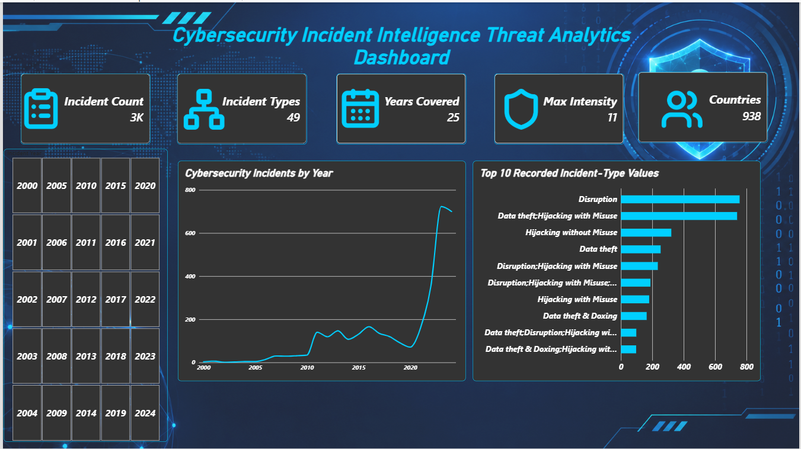
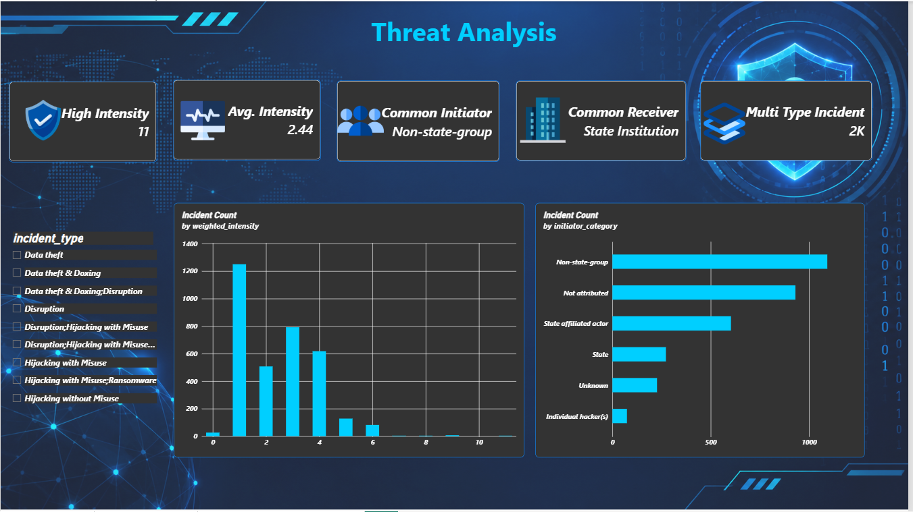
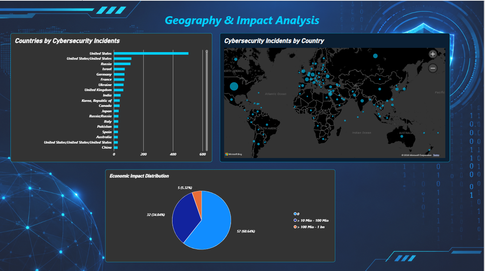

# Cybersecurity Incident Intelligence & Threat Analytics Dashboard

## Project Information

- **Project Title:** Cybersecurity Incident Intelligence & Threat Analytics Dashboard
- **Industry:** Cybersecurity / Information Security
- **Problem Statement:** Security teams need to understand historical incident patterns, threat categories, affected receiver groups, geographic distribution, and incident intensity to support security awareness, risk assessment, and planning. Public incident data can be difficult to explore consistently without structured querying and visual summaries.
- **Project Objectives:**
  - Analyze documented cybersecurity incidents using SQL and Power BI.
  - Examine incident trends across the available years.
  - Explore recorded incident types and initiator and receiver categories.
  - Review weighted incident intensity and identify higher-intensity records using a project-defined threshold.
  - Present findings in an interactive dashboard that supports filtering and exploration.
- **Proposed Solution / Business Questions:** Use MySQL for structured data storage and SQL-based profiling and analysis, then use Power Query, DAX, and Power BI visuals to summarize the historical dataset. Questions include:
  - How have recorded incidents changed over time?
  - Which incident-type values occur most often?
  - Which initiator and receiver categories are most common?
  - How are incidents distributed by weighted intensity?
  - How do the results vary when filtering by year?
- **Dataset Name:** EuRepoC Global Dataset v1.3
- **Dataset Source:** European Repository of Cyber Incidents (EuRepoC), Global Dataset v1.3. Acknowledge the dataset provider and applicable usage terms when redistributing the data.
- **Database Name:** `cybersecurity_incident_db`
- **Main Table:** `eurepoc_incidents_raw`
- **Cleaned View:** `eurepoc_incidents_clean`

## Tools & Technologies

- MySQL Server 8.0.46
- SQL
- Power BI Desktop
- Power Query
- DAX
- Excel workbook (`.xlsx`) for the source dataset and import workflow

## Project Overview

This project explores historical cybersecurity incident records from the EuRepoC Global Dataset v1.3. The objective is to turn a structured public dataset into useful summaries of incident trends, recorded incident types, initiator and receiver categories, and weighted intensity.

MySQL is used to store the imported records and perform data checks and SQL-based analysis. A SQL view provides a cleaned receiver-country field that standardizes blank, null, and "Not available" values as "Unknown." Power Query is used for Power BI preparation, including creation of a parsed start-date column. DAX measures and Power BI visuals summarize the records in a dashboard.

The dashboard is an educational, portfolio-oriented historical analysis. It is not a live security monitoring system and does not represent a deployment for a specific company. Its potential business value is to help readers explore patterns in documented incidents and formulate further questions for security research and risk planning. Findings should be interpreted in the context of the dataset's coverage and data quality.

## Project Objectives

1. Store the source incident records in MySQL.
2. Profile data completeness and inspect key fields using SQL.
3. Standardize selected missing receiver-country values in a SQL view without overwriting the raw table.
4. Prepare date and numeric fields for analysis in Power BI.
5. Build DAX measures for incident counts, year coverage, distinct incident-type values, maximum weighted intensity, distinct known receiver-country values, and other dashboard-specific metrics.
6. Create dashboard pages for executive overview, threat analysis, and geography and impact analysis.
7. Communicate findings through interactive visuals and filters.

## Dataset Information

- **Dataset:** EuRepoC Global Dataset v1.3
- **Records imported:** 3,414 incident records
- **Approximate date coverage:** 1 January 2000 to 19 December 2024
- **Source format:** Excel workbook (`.xlsx`)
- **Raw MySQL table:** `eurepoc_incidents_raw`
- **Analysis view:** `eurepoc_incidents_clean`

Important fields used or examined in the project include:

- `incident_id` — incident identifier
- `start_date` — recorded incident start date, initially stored as text
- `end_date` — recorded incident end date
- `incident_type` — recorded incident type or semicolon-separated combination of types
- `initiator_category` — recorded initiator category
- `receiver_category` — recorded receiver category
- `receiver_country` — recorded receiver country
- `weighted_intensity` — recorded weighted intensity score
- `unweighted_intensity` — recorded unweighted intensity score
- `economic_impact` — economic impact field, with many unavailable or missing values

**Data-quality notes:**

- SQL profiling found 3,414 records and 3,414 distinct incident IDs.
- The `receiver_category` field had 17 missing values in the profiling checks.
- The `economic_impact` field was unavailable or missing for 3,320 records in the profiling check.
- Missing economic-impact values should not be interpreted as zero.
- Some `incident_type` values contain multiple types separated by semicolons.
- Some receiver-country values contain multiple country names in one field. These details affect how distinct-value counts should be interpreted.

The project uses a parsed Power Query date column named `start_date_clean`, created from the source `start_date` text using the `dd.MM.yyyy` format. The original field is retained.

## Project Workflow

**Industry Selection → Problem Identification → Dataset Collection → MySQL Database Setup → Data Cleaning & Transformation Using SQL → SQL Data Analysis → Power BI Data Modeling → Dashboard Development → Insights & Recommendations**

### 1. Industry Selection and Problem Identification

Selected cybersecurity incident intelligence as the analysis domain and defined questions around trends, categories, geography, and intensity.

### 2. Dataset Collection

Imported the EuRepoC Global Dataset v1.3 workbook containing 3,414 incident records.

### 3. MySQL Database Setup

Created the `cybersecurity_incident_db` database and imported the source records into `eurepoc_incidents_raw`.

### 4. Data Cleaning and Transformation

Created the `eurepoc_incidents_clean` SQL view to expose a standardized `receiver_country_clean` field. In Power Query, created `start_date_clean` using the source date format and prepared selected fields for reporting. The raw table was preserved.

### 5. SQL Data Analysis

Used SQL for row counts, distinct-ID checks, missing-value profiling, date-range checks, and intensity-value frequency checks.

### 6. Power BI Data Modeling and Dashboard Development

Connected Power BI to MySQL, prepared the date field, created DAX measures, and developed dashboard visuals with a consistent dark navy and cyan visual theme.

The dashboard pages are:

- `Executive_Overview`
- `Threat_Analysis`
- `Geographic_Impact_Analysis`

## SQL Analysis

SQL work performed or prepared for the project includes:

- Database creation and selection
- Source table inspection and row-count validation
- Distinct incident-ID checks
- Missing-value profiling for key fields
- Date parsing and date-range checks using the source format `dd.MM.yyyy`
- Frequency checks for `weighted_intensity`
- Creation of the `eurepoc_incidents_clean` view with a standardized `receiver_country_clean` field

Example profiling queries:

```sql
-- Total number of records
SELECT COUNT(*) AS total_incidents
FROM eurepoc_incidents_raw;

-- Number of unique incident IDs
SELECT COUNT(DISTINCT incident_id) AS unique_incident_ids
FROM eurepoc_incidents_raw;

-- Weighted intensity distribution
SELECT weighted_intensity, COUNT(*) AS incident_count
FROM eurepoc_incidents_raw
GROUP BY weighted_intensity
ORDER BY weighted_intensity;
```

These examples illustrate the SQL checks used in the project. Keep them consistent with the final SQL files committed to the repository.

## Power BI Dashboard

The dashboard uses data from the MySQL view `eurepoc_incidents_clean`.

### Data Preparation

- Connected Power BI to MySQL.
- Created `start_date_clean` in Power Query by parsing the original `start_date` text in `dd.MM.yyyy` format.
- Retained the original `start_date` field.
- Prepared `weighted_intensity` and `unweighted_intensity` as whole-number fields where appropriate.
- Kept `economic_impact` as text because the source includes unavailable values. Missing values were not converted to zero.

### DAX Measures and Calculated Columns

Measures created or used during development include:

- `Incident Count`
- `Years Covered`
- `Max Intensity`
- `Initiator Categories`
- `Countries`
- `High Intensity Incidents`
- `Most Common Initiator`
- `Most Common Receiver`
- `Multi-Type Incidents`

Verify that each measure is saved and working in the final Power BI file before describing it as complete.

A calculated column used for time-based analysis:

- `Incident Year`

### Dashboard Pages and Visuals

#### 1. Executive Overview

- Total incident count
- Years covered
- Distinct recorded incident-type values
- Maximum weighted intensity
- Known receiver-country count
- Incidents by year
- Top recorded incident-type values

#### 2. Threat Analysis

- Higher-intensity incident count
- Most common initiator
- Most common receiver
- Multi-type incidents
- Incident distribution by weighted intensity
- Initiator and receiver category analysis

#### 3. Geographic Impact Analysis

- Geographic distribution of recorded incidents
- Top countries by recorded incident count
- Economic-impact distribution, subject to available data

A year slicer may be used to filter the report where applicable. KPI and chart values should be interpreted according to active filters and the fields used in each visual.

## Data Analysis & Visualization

The project focuses on:

- **Time-based analysis:** Recorded incidents by year.
- **Category analysis:** Recorded incident-type values and initiator/receiver categories.
- **Intensity distribution:** Counts by weighted intensity and a project-defined high-intensity threshold of `weighted_intensity >= 7`.
- **Geographic analysis:** Receiver-country values, with unavailable country values standardized to `Unknown` in the SQL view.
- **Data-quality analysis:** Missing values, duplicate-ID checks, and date coverage.
- **Impact analysis:** Exploration of available economic-impact information, taking missing values into account.

The threshold of 7 or higher is a project-defined analytical choice. It should not be presented as an official severity classification unless a source establishes that interpretation.

## Key Insights

The following findings are supported by checks performed during development:

1. The imported dataset contains **3,414 incident records** and **3,414 distinct incident IDs**.
2. The recorded date range spans **1 January 2000 to 19 December 2024**, based on parsing the source date strings.
3. The `economic_impact` field was unavailable or missing for **3,320 records** in the profiling check. This limits conclusions based on economic impact.
4. The `receiver_category` field had **17 missing values** in the profiling check.
5. The `weighted_intensity` field had recorded values from **0 to 11** in the checks performed.
6. The `incident_type` field can contain semicolon-separated combinations, so a count of distinct raw field values is not the same as a count of normalized individual incident types.

Add other findings, rankings, percentages, and chart-specific conclusions only after checking the final SQL query results or Power BI visuals.

## Power BI Dashboard Screenshots

Store screenshots in the `Screenshots/` folder using these filenames.

### Executive Overview

`Screenshots/Executive_Overview.png`



### Threat Analysis

`Screenshots/Threat_Analysis.png`



### Geographic Impact Analysis

`Screenshots/Geographic_Impact_Analysis.png`



The images will render only after the corresponding screenshot files have been uploaded using those exact names.

## Project Folder Structure

The repository is named `Cybersecurity-Incident-Intelligence`.

```text
Cybersecurity-Incident-Intelligence/
├── README.md
├── SQL/
│   ├── database_creation.sql
│   ├── table_creation.sql
│   ├── data_cleaning.sql
│   └── analysis_queries.sql
├── Dataset/
│   ├── Raw_Dataset/
│   └── Cleaned_Dataset/
├── PowerBI/
│   └── Cybersecurity_Incident_Analytics.pbix
├── Screenshots/
│   ├── Executive_Overview.png
│   ├── Threat_Analysis.png
│   └── Geographic_Impact_Analysis.png
└── Documentation/
    └── Cybersecurity_Incident_Intelligence.pdf
```

Keep only files and folders that actually exist in the repository. Add dataset files, the `.pbix` file, screenshots, and documentation after they have been uploaded. Confirm that `table_creation.sql` contains the actual table-creation script before describing it as such.

## Limitations

- This is a historical dataset, not a live security-event feed.
- Dataset coverage and recording practices can affect trends and comparisons.
- Some fields have substantial missing or unavailable data.
- Semicolon-separated categories are not fully normalized into individual category records in the current workflow.
- The `weighted_intensity >= 7` threshold is defined for this project and is not asserted to be an official severity standard.
- The project does not calculate verified incident response times, mean time to acknowledge, mean time to resolve, analyst performance, or patch status.

## Author

- **Name:** AKASHRAJ R
- **Student ID:** AF05321609
- **Organization:** Anudip Foundation
- **Course:** DBA_AI
- **Batch Code:** ANP - D7635

---

*This project is intended for educational and portfolio purposes. Please acknowledge the original dataset provider and follow the dataset's applicable licensing and usage terms when sharing the data.*
